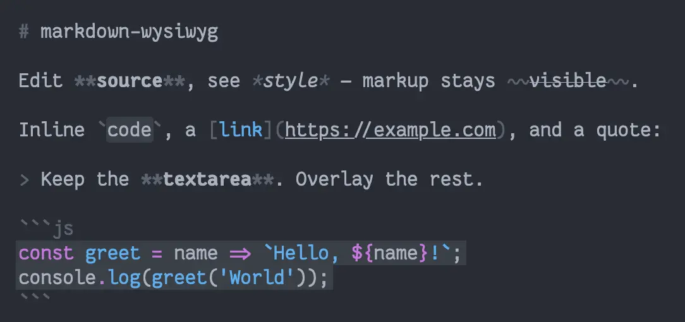
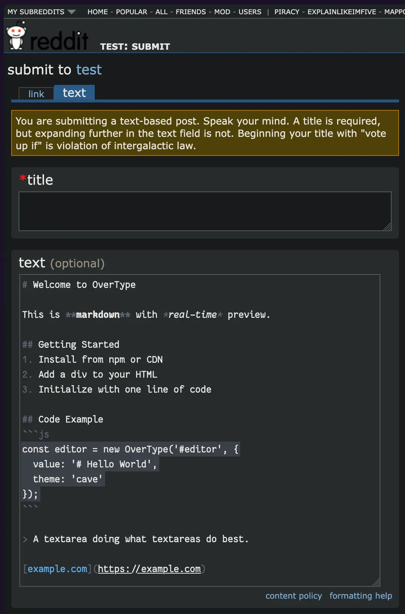

# markdown-wysiwyg

<table><tr><td>

A lightweight Markdown editor that keeps a normal `<textarea>` (or text input) and overlays styled rendering on top.<br><br>No `contenteditable`. No split preview pane. No editor framework.<br><br>You still edit the Markdown source; markup stays visible (muted), while the content looks bold, italic, linked, etc. in place — Typora-like feedback without replacing the input.

</td><td>



</td></tr></table>

## Why

Most “WYSIWYG” Markdown UIs either:

- hide the syntax entirely, or
- put you through `contenteditable` / CodeMirror / EasyMDE and ship their own toolbar, caret, and undo stack.

This library does neither. The browser owns typing (caret, selection, IME, undo). The library only paints a non-interactive overlay that stays aligned with the input.

That also means it can sit on top of an existing field and toolbar — useful for apps that already have Markdown chrome and only want live styling, and for userscripts / extensions that enhance third-party sites without replacing their inputs.

## How it works

1. **`markdown-tokens`** lexes the source into character-aligned spans (including markup characters, not just rendered content).
2. **`parseMarkdown`** turns those tokens into active style sets per span.
3. **`createRender`** rebuilds a line/span DOM for the overlay (fenced code bodies highlighted with [`@speed-highlight/core`](https://github.com/speed-highlight/core)).
4. **`generateCss`** injects One Dark–style rules: transparent input text, visible caret, muted markup, styled content.
5. **`createAutoRender`** (optional) measures an existing input, positions the overlay, and re-renders on `input`.

## Install

Not published under this name on the public npm registry (that package name is taken). Use the repo directly:

```bash
bun add git+ssh://git@git.kaki87.net:3021/KaKi87/markdown-wysiwyg.git
# or clone and import from the local path
```

ESM only. Peer runtime: browser DOM. Dependencies resolve from npm (`markdown-tokens`, `@speed-highlight/core`).

## Usage

### Manual overlay (demo-style)

```html
<div class="app">
  <div class="app__output"></div>
  <textarea class="app__input" aria-label="Markdown input"></textarea>
</div>
```

```js
import { createRender, generateCss } from 'markdown-wysiwyg';

const inputElementClassName = 'app__input';
const outputElementClassName = 'app__output';
const outputLineElementClassName = 'app__output__line';

const input = document.querySelector(`.${inputElementClassName}`);
const render = createRender({
  outputElement: document.querySelector(`.${outputElementClassName}`),
  outputLineElementClassName,
});

input.addEventListener('input', () => render(input.value));
render(input.value);

const sheet = new CSSStyleSheet();
sheet.replaceSync(generateCss({ inputElementClassName, outputElementClassName }));
document.adoptedStyleSheets.push(sheet);
```

### Auto-overlay an existing field

```js
import { createAutoRender, generateCss } from 'markdown-wysiwyg';

const input = document.querySelector('textarea');
const outputElementClassName = 'md-wysiwyg-output';

const { start, stop } = createAutoRender({
  inputElement: input,
  outputElementClassName,
  // fontFamily, fontSize, zIndex optional
});

const sheet = new CSSStyleSheet();
sheet.replaceSync(generateCss({
  inputElementClassName: input.className.split(/\s+/).find(Boolean) ?? 'md-wysiwyg-input',
  outputElementClassName,
}));
document.adoptedStyleSheets.push(sheet);

start();  // begin live overlay
// stop();
```

`createAutoRender` is meant for cases where you do not control the page layout — e.g. overlaying a host site’s composer from a userscript:



## API

| Export | Role |
| --- | --- |
| `createRender({ outputElement, outputLineElementClassName, getOutputLineItemElementClassName? })` | Returns `async (markdown) => void` that paints into `outputElement`. |
| `createAutoRender({ inputElement, outputElementClassName, ... })` | Creates and positions an overlay; returns `{ start, stop }`. |
| `generateCss({ inputElementClassName, outputElementClassName, ... })` | Returns a CSS string for transparent input + styled overlay. |

Class names follow a BEM-ish pattern (`…__line`, `…__item--bold`, `…__item--markup`, …). Override `getOutputLineItemElementClassName` if you need a different scheme.

## Demo

Open [`demo/main.html`](demo/main.html) via a local static server (ES modules + import map). Draft text is stored in `localStorage`.

## Related projects

Same *typing ownership* idea (native field + visual layer), different scope:

| Project | Notes |
| --- | --- |
| [panphora/overtype](https://github.com/panphora/overtype) | Full Markdown product on the same overlay technique; built-in HTML parser |
| [react-simple-code-editor](https://github.com/react-simple-code-editor/react-simple-code-editor) | Code snippets; `<textarea>` + highlighted `<pre>` |
| [lonekorean/highlight-within-textarea](https://github.com/lonekorean/highlight-within-textarea) | Marks inside a still-native textarea |
| [PrismJS/live](https://github.com/PrismJS/live) | Prism’s editable overlay editor |

Technique write-ups: [CSS-Tricks](https://css-tricks.com/creating-an-editable-textarea-that-supports-syntax-highlighted-code/), [Helge Sverre](https://helgesver.re/articles/syntax-highlighting-textarea-overlay), [satya164](https://satya164.page/posts/how-to-write-a-minimal-code-editor).

This repo stays a small proof of concept: token-based overlay, no toolbar, no modes beyond “styled source”.

## Dependencies

- [markdown-tokens](https://git.kaki87.net/VibedByKaKi/markdown-tokens) — source-faithful Markdown lexer (markup included)
- [@speed-highlight/core](https://github.com/speed-highlight/core) — fenced code highlighting

## TODO

- Tables syntax support
- Nested lists syntax support
- Colors for headings

## License

MIT © KaKi87
